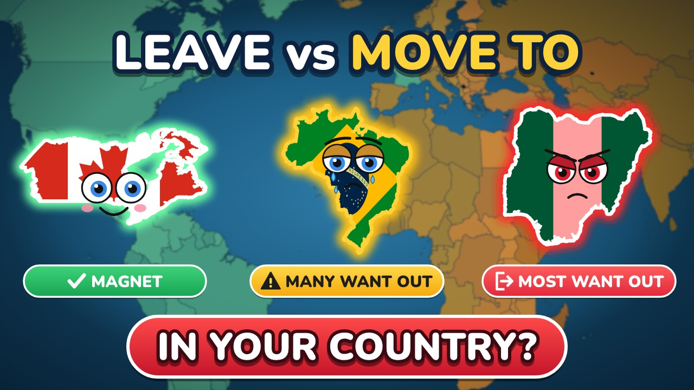

# Countries People Want to LEAVE vs MOVE TO



An animated world-map video (9:43, 1920x1080, 30 fps) for an English-language YouTube channel. The camera flies over
**159 countries in 11 regions**. A narrator names each country as it fills with its flag, gets a cartoon face, a status colour and
a number chip. The film ends on a final map with the totals:

| Status | Rule (short) | Countries |
|---|---|---|
| MAGNET | Gallup Potential Net Migration Index +50% or more, or a top dream destination | 16 |
| MORE WANT IN | PNMI +10..+49%, or UN net migration +2 per 1,000 or more | 16 |
| MOST STAY | under 20% want to leave, or PNMI / UN close to zero | 47 |
| MANY WANT OUT | 20-39% want to leave, or PNMI -10% or lower, or UN -2 per 1,000 or lower | 52 |
| MOST WANT OUT | 40% or more want to leave | 26 |
| CAN'T LEAVE | documented exit ban (North Korea, Eritrea) | 2 |

Every frame is drawn by code. Nothing is stock footage or AI-generated imagery. The whole film is a pure function of time
(`drawFrame(t)` on an HTML canvas) rendered headless with Playwright, so any frame can be reproduced exactly.

The project was built in eight stages (0-7), and each stage was approved before the next one started. The process is written up
as a reusable skill in [`skill/animated-map-status-video/SKILL.md`](skill/animated-map-status-video/SKILL.md). The full stage
prompts are in `skill/animated-map-status-video/references/` (in Russian).

## Data

Facts are as of 4 November 2026. Each country is in `countries.csv` with its source id, period and data quality:

- **G (Gallup World Poll):** % of adults who would like to move permanently to another country (mostly 2023), the Potential Net
  Migration Index 2023-2025, and dream-destination shares (2025).
- **S (other survey):** national or regional polls such as Arab Barometer, Caucasus and Balkan Barometers, Levada and SWS. These
  countries get a dotted outline on the map, because the polls ask different questions.
- **E (estimate):** UN World Population Prospects 2024, crude net migration rate averaged over 2019-2023. This counts actual moves,
  not wishes, and these countries are hatched on the map.
- **Barrier chips:** Henley Passport Index 2026 and the US entry ban (Proclamation of 16 December 2025).

All 24 sources with URLs are listed in `sources.txt`. `fact_check.html` lists every on-screen claim next to its source.

## Repository layout

```
project_brief.txt, project_status.txt   rules, metrics, statuses; dated log of every stage and decision
countries.csv facts.csv scenes.csv      registry (159 countries), facts, route and shots
sources.txt fact_check.html             sources and claim-by-claim check
voice_en.txt voice_ru.txt voice_numbers.csv   narration script, translation, every spoken number
audio/voice_en_source.wav               the narration (583.2 s)
tools/                                  stage 2-3 builders: data, scenes, TTS, voice check
engine/                                 engine template inherited from the previous video
stage4/                                 10-second visual test
stage5/                                 the film engine
  index.html                            canvas engine (map, camera, faces, chips, HUD, final map)
  data/world.js, data/episode.js        Natural Earth geometry; generated episode (shots, stops, events)
  tools/plans.py, tools/build_mig.py    region plans -> episode.js + sync table
  tools/asr_words.py, tools/align.py    word timestamps from the real WAV, aligned to the script
  tools/qa_region.py                    per-region QA (seams, boundary, audio)
  render/render.js, render_region.sh    headless render
  sync/                                 word timestamps, sync_table.csv, region intervals
stage6/                                 assembly, music and QC (tools/, qa/, README_stage6.txt)
stage7/                                 thumbnail (+ HTML/SVG source in thumbnail/), title, description, tags, pinned comment
skill/animated-map-status-video/        the reusable skill
```

## Requirements

- Node.js 18+ with `playwright` (Chromium)
- ffmpeg with `libx264`, `aac`, `ebur128` and `alimiter`
- Python 3.10+ with `numpy`, `Pillow` and `soundfile`
- For voice and sync only: `kokoro-onnx` (TTS) and `sherpa-onnx` with the Parakeet TDT 0.6B v2 int8 model. The models are not
  included.

## How to rebuild

```bash
cd stage5
# 1. word timestamps of the narration -> sync/parakeet_words.json, then align to the script
python3 tools/asr_words.py
python3 tools/align.py sync/parakeet_words.json ../voice_en.txt sync
# 2. episode from the registry + region plans -> data/episode.js, sync/sync_table.csv, sync/region_Rxx.json
MIG_ROOT=.. python3 tools/build_mig.py
# 3. preview stills or one region (frames [n0, n1), 4 workers)
node render/render.js frames /tmp/stills 10,45.5,92
bash render/render_region.sh R01 0 3389 4
python3 tools/qa_region.py R01 0 3389 /tmp/qa_R01
```

Region intervals are listed in `sync/region_Rxx.json`. The first and last are R01 `[0, 3389)` and R11 `[15352, 17497)`.

```bash
cd stage6
# 4. music bed (deterministic, own work) and final mix; see README_stage6.txt for the voice chain and joins
python3 tools/synth_music.py music/bed_synth.wav 583.2333
python3 tools/mix_music.py video_full.mp4 voice_proc.wav music/bed_synth.wav final.mp4 qa/mix_report.json
python3 tools/qc_final.py final.mp4 ../stage5 voice_full.wav qa
```

The thumbnail source is in `stage7/thumbnail/`: `node render_thumbnail.js` renders `thumbnail.html` to a 1280x720 PNG.

## Not in the repository

The rendered files are too large for git, and all of them can be rebuilt with the commands above:

- the final MP4 (476 MB) and the voice-only MP4
- the region renders `stage5/export/Rxx/*.mp4` (1.4 GB)
- the music WAV

## Final file

1920x1080, 30 fps, H.264 High, 17,497 frames, 583.23 s, AAC 48 kHz stereo 256 kb/s. Loudness is -14.3 LUFS integrated with a
true peak of -1.4 dBTP. The music sits about 19 dB under the voice. The 10 region seams were checked frame by frame, and there
is no audio drift (lag 0 samples).

## Credits and licences

| Asset | Source | Licence |
|---|---|---|
| Borders | Natural Earth 1:10m via world-atlas 2.0.2 | public domain |
| Flags | svg-country-flags 1.2.10 | public domain |
| Fonts | Lilita One, Nunito | SIL Open Font License |
| Voice | Kokoro TTS, voice `am_michael` (kokoro-onnx) | Apache 2.0 |
| Music | original track synthesized in code for this video (`stage6/tools/synth_music.py`) | own work |
| Survey figures | the sources listed in `sources.txt` | quoted with attribution; the numbers belong to their publishers |

The code in this repository is released under the [MIT License](LICENSE). Third-party assets keep their own licences
(table above): fonts under the SIL OFL, borders and flags in the public domain, survey figures belonging to their publishers.
